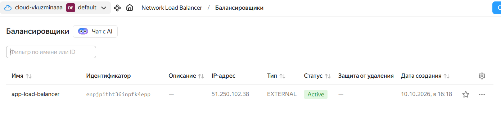
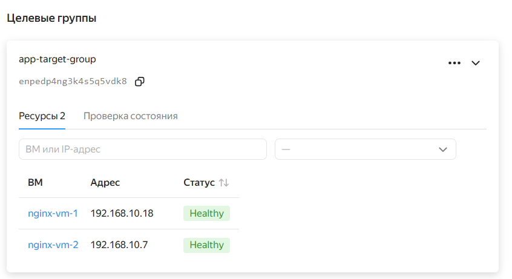
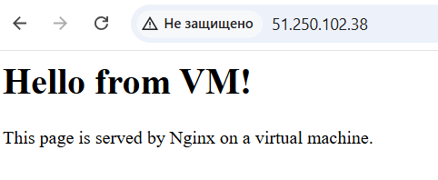

# Домашнее задание к занятию «Отказоустойчивость в облаке»

**Выполнила:** Кузьмина Варвара

## Задание 1. Конфигурация отказоустойчивого кластера в Yandex Cloud

### Что было сделано

В рамках задания был написан Terraform-playbook, который создаёт отказоустойчивую инфраструктуру в Yandex Cloud:

1. **Облачная сеть и подсеть** — `yandex_vpc_network` и `yandex_vpc_subnet` в зоне `ru-central1-a`.
2. **Две идентичные виртуальные машины** — создаются с помощью аргумента `count`. На каждой ВМ через `cloud-init` автоматически устанавливается и запускается веб-сервер Nginx на порту 80.
3. **Целевая группа** — `yandex_lb_target_group` с двумя созданными ВМ.
4. **Сетевой балансировщик нагрузки** — `yandex_lb_network_load_balancer`, который:
   - слушает на порту 80,
   - отправляет трафик на порт 80 виртуальных машин,
   - выполняет HTTP-healthcheck на порт 80 виртуальных машин (path `/`).

### Файлы Terraform

- `provider.tf` — настройки провайдера Yandex Cloud (аутентификация через сервисный аккаунт).
- `main.tf` — описание инфраструктуры (сеть, подсеть, две ВМ, целевая группа, балансировщик).
- `cloud-init.yaml` — скрипт автоматической установки Nginx на виртуальные машины.

### Результаты проверки

**Внешний IP-адрес балансировщика:** `51.250.102.38`

#### Скриншот 1. Балансировщик в статусе Active

#### Скриншот 2. Целевая группа: обе ВМ в статусе Healthy

#### Скриншот 3. Страница Nginx по IP-адресу балансировщика

### Вывод

Написанный Terraform-playbook успешно создаёт отказоустойчивый кластер из двух виртуальных машин за балансировщиком нагрузки. Обе ВМ в целевой группе находятся в статусе **Healthy**, а по IP-адресу балансировщика отдаётся дефолтная страница Nginx. При падении одной из ВМ балансировщик автоматически перестанет отправлять трафик на неё, и сервис продолжит работу за счёт второй машины.
